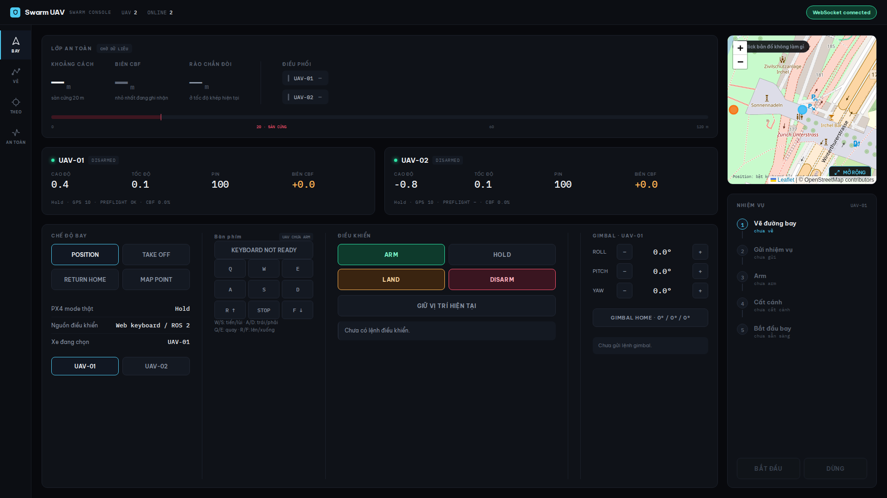
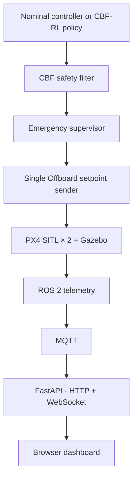

# Swarm Dashboard · PX4 SITL + CBF-RL

A robotics dashboard for two simulated PX4 vehicles. It brings live telemetry, mission planning, and sensor views into one browser interface, with a companion-side safety pipeline for evaluating learned motion policies.

[Verified results](#verified-results) · [Run the offline checks](#run-the-offline-checks) · [Run the SITL smoke test](#run-the-sitl-smoke-test) · [Full-stack runbook](RUN_FULL_STACK.md)



*Live dashboard captured during the stock X500 telemetry smoke test.*

## Verified results

| Check | Result | Evidence |
| --- | --- | --- |
| PX4 SITL telemetry | **2/2 vehicles online and disarmed**. The dashboard received fresh position data and matched PX4 system IDs 1 and 2. | [Smoke report](docs/benchmarks/sitl/smoke.json) |
| CBF-RL point-mass benchmark | `mission_v1` completed **5/5 scenarios** versus **3/5** for its goal-only baseline. Minimum reported CBF margin was **+0.847 m**, with zero hold frames. | [Per-scenario JSON and replay instructions](docs/benchmarks/cbf-rl/README.md) |
| Offline regression suite | **329 tests and 99 subtests passed** in a clean checkout. The suite covers dashboard access, control authority, CBF, watchdogs, and flight-report validation. | [CI workflow](.github/workflows/offline.yml) · [Test entry point](scripts/test-core.sh) |

The same five-scenario benchmark records `v1` and `v2` at 1/5 each and a FAIL verdict. The benchmark measures policy behavior in a point-mass simulation. The stock SITL smoke test verifies telemetry while disarmed. Flight experiments use the custom X500 setup described in the runbook.

## Architecture



- **Safety and authority.** The optional CBF-RL path proposes nominal velocity. A control barrier function (CBF) filters the proposal, and the supervisor can hold it. Offboard authority is explicit, and stale or invalid state is covered by offline fault tests. [Companion safety pipeline](companion_safety.py) · [CBF gate](cbf_command_gate.py)
- **Operator view.** FastAPI streams vehicle state to the dashboard. The custom X500 setup adds camera, gimbal and LiDAR integration, including RGB target tracking. [Dashboard](static/index.html) · [Visual follow notes](VISUAL_FOLLOW_TARGET.md)
- **Runtime verification.** The launcher separates process health from readiness, and SITL evidence is checked against a shared run ID and flight time window. [Smoke verifier](scripts/check_sitl_telemetry.py) · [SITL evaluator](cbf_rl_sitl_evaluate.py)

## Run the offline checks

From the repository root with Python 3.12. On Ubuntu 24.04 the test dependencies use the system packages `libgl1` and `libglib2.0-0t64`.

```bash
python3.12 -m venv .venv
.venv/bin/python -m pip install -r requirements-test.txt
PYTHON=.venv/bin/python bash scripts/test-core.sh
.venv/bin/python cbf_rl_evaluate.py --model cbf_rl_policy_mission_v1.json
```

These checks run without PX4, Gazebo, ROS 2, an MQTT broker, or research datasets.

## Run the SITL smoke test

With a stock PX4 SITL build and the ROS telemetry workspace available, run `./run_all.sh --smoke`. It starts two stock X500 instances headless, verifies live telemetry, writes `smoke.json`, and cleans up the processes it started. The ROS workspace supplies the external `swarm_telemetry` package. [Prerequisites and exact command](docs/benchmarks/sitl/README.md)

For the interactive dashboard at `http://127.0.0.1:8000`, follow the [full-stack runbook](RUN_FULL_STACK.md). It documents the external `x500_custom` assets, default-off control options, and authenticated remote access. [Research and archives](docs/README.md)
